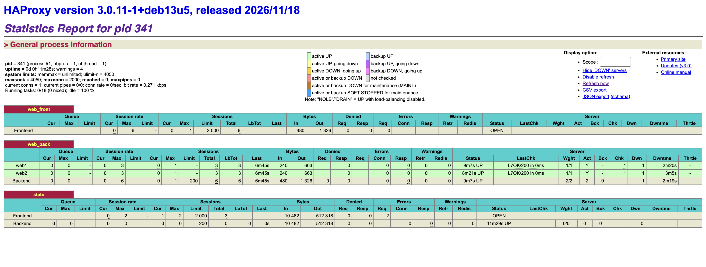
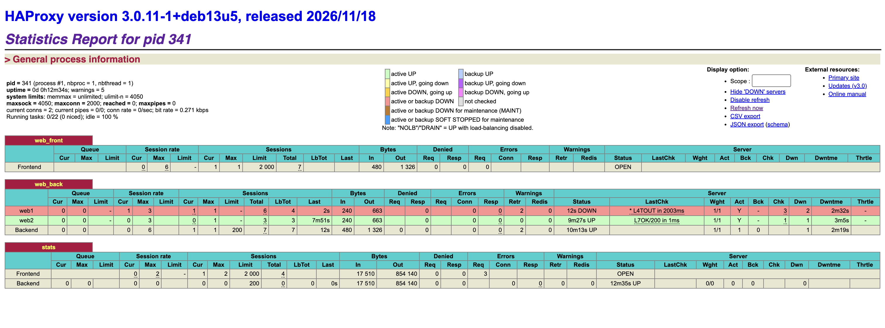

# Étape 2a — Répartition de charge avec HAProxy

## Plan d'adressage

Les serveurs ont des IP fixes, choisies **hors de la plage DHCP de Fusion**
(`.128` → `.254`) pour éviter tout conflit d'adresse.

| ID  | Nom     | IP               | Rôle                                  |
|-----|---------|------------------|---------------------------------------|
| —   | pve     | 192.168.61.133   | hôte Proxmox VE                       |
| 201 | web1    | 192.168.61.21    | nginx                                 |
| 202 | web2    | 192.168.61.22    | nginx                                 |
| 210 | haproxy | 192.168.61.20    | répartiteur de charge (ports 80, 8404) |
| 220 | squid   | 192.168.61.30    | proxy sortant (étape 2b)              |

Passerelle et DNS : `192.168.61.2` (NAT Fusion).

## Serveurs web

Chaque conteneur est cloné depuis le modèle 900 et reçoit une IP fixe :

```bash
pct clone 900 201 --hostname web1 --full
pct set 201 --net0 name=eth0,bridge=vmbr0,ip=192.168.61.21/24,gw=192.168.61.2
pct set 201 --onboot 1 --startup order=1
```

nginx sert une page qui affiche le nom du serveur, pour visualiser la répartition :

```bash
pct exec 201 -- bash -c 'apt-get install -y nginx && echo "<h1>Bonjour depuis $(hostname)</h1>" > /var/www/html/index.html'
```

## HAProxy

Configuration : [`configs/haproxy/haproxy.cfg`](../configs/haproxy/haproxy.cfg)

| Section    | Rôle                                                              |
|------------|-------------------------------------------------------------------|
| `global`   | réglages du processus (journaux, connexions max)                  |
| `defaults` | mode HTTP, timeouts, `retries 3` + `option redispatch`            |
| `frontend` | écoute sur le port 80                                             |
| `backend`  | `roundrobin` entre web1 et web2, health check HTTP toutes les 2 s |
| `listen stats` | page de statistiques sur `:8404/stats`                        |

Déploiement, avec validation avant rechargement :

```bash
pct push 210 /root/haproxy.cfg /etc/haproxy/haproxy.cfg
pct exec 210 -- haproxy -c -f /etc/haproxy/haproxy.cfg   # code retour 0 = valide
pct exec 210 -- systemctl reload haproxy                  # sans couper les connexions
```

HAProxy démarre après les serveurs web (`--startup order=2`).

## Tests

**Répartition** — les réponses alternent :

```bash
for i in $(seq 1 6); do curl -s http://192.168.61.20; done
# web1, web2, web1, web2, web1, web2
```

**Bascule** — arrêt de web1 pendant un flux de requêtes :

```bash
pct stop 201 & for i in $(seq 1 40); do curl -s -o /dev/null -w "%{http_code} " http://192.168.61.20; sleep 0.2; done
# 40 × 200 : aucune erreur visible côté client
```

Sur la page de stats, web1 passe de `L7OK/200` (vert) à `L4TOUT` (rouge, plus
de connexion TCP), puis redevient vert après deux vérifications réussies
(`rise 2`).

## Amélioration : `option redispatch`

Premier test de bascule sans cette option : la page de stats montrait une
erreur de connexion sur web1 (`Errors Conn = 1`, `Retr = 3`). Entre l'arrêt de
web1 et sa détection (jusqu'à 2 × 2 s), une requête lui a été envoyée,
HAProxy a réessayé sur le même serveur, puis a renvoyé une erreur au client.

Avec `retries 3` + `option redispatch`, la nouvelle tentative part vers un
autre serveur disponible. Résultat : 40 requêtes sur 40 en `200` pendant la
panne.

## Captures




